# 개발 워크스테이션 구축 

## 프로젝트 개요
- **미션**: 내 컴퓨터에 개발자용 '작업실' 꾸미기
- **목표**: 리눅스 CLI(터미널), Docker(컨테이너), Git/GitHub(버전 관리·협업)를 직접 세팅하고, 실행 결과(로그·접속·데이터 유지)로 동작을 검증한다.
- **흐름**: 터미널로 작업 디렉토리·권한 정리 → Docker 설치·점검 → Dockerfile로 웹 서버 이미지 제작 → 포트 매핑 접속 → 바인드 마운트/볼륨으로 변경 반영·데이터 영속성 검증 → Git/GitHub 연동→ 보너스과제


## 실행 환경

| 항목 | 내용 |
|---|---|
| 호스트 OS | Windows  |
| Linux | WSL 2, Ubuntu 26.04.1 LTS |
| 셸 | /bin/bash |
| 커널 | Linux 6.18.54.1 |
| 터미널 | Windows Terminal (WSL Ubuntu) |
| Docker | 29.1.3 |
| Git | git version 2.55.0.windows.4 |
| 작업 경로 | 리눅스 홈 `~/codyssey/docker-custom` |

## 수행 체크리스트
- [x] 터미널 기본 조작 (STEP 1)
- [x] 권한 변경 실습 (STEP 2)
- [x] Docker 설치/점검 (STEP 3)
- [x] Docker 이미지/컨테이너/로그/리소스 확인 (STEP 3)
- [x] hello-world, ubuntu 컨테이너 실행 (STEP 4)
- [x] Dockerfile 빌드/실행 (STEP 5)
- [x] 포트 매핑 접속 2회 (STEP 6)
- [x] 볼륨 영속성 (STEP 7)
- [x] 바인드 마운트 반영 (STEP 8)
- [x] Git 설정 + VSCode GitHub 연동 (STEP 9)
- [x] 보너스과제

--------------------------------------------------------------------------------------  
## 📌 STEP 1. 리눅스 CLI     
-------------------------------------------------------------------------------------- 

 
<br> <br> 

| 용어 | 정체 | 한 줄 설명 | 이번 과제에서 |
|---|---|---|---|
| **Ubuntu** | 운영체제 (리눅스의 한 종류) | 윈도우처럼 컴퓨터를 돌리는 OS예요. 리눅스에는 Ubuntu, Debian 등 여러 종류가 있어요. | WSL에 설치한 OS예요. STEP 4에서 `docker run -it ubuntu`로 컨테이너 안에 작은 Ubuntu도 띄웠어요. |
| **bash** | 셸 (명령 해석 프로그램) | 내가 친 글자를 OS가 알아듣게 전달해요. 터미널에 `ls`, `cd`를 치면 받아 주는 게 bash예요. | `echo $SHELL`을 쳤을 때 `/bin/bash`가 나왔어요. STEP 1에서 확인했어요. |
| **nginx** | 웹 서버 프로그램 | 브라우저가 주소로 접속하면 HTML 파일을 보내 주는 프로그램이에요. | 이미지(`nginx`, `nginx:alpine`)를 받아 웹 서버로 썼어요. STEP 5에서 내 `index.html`을 얹었고, 8080 포트로 접속해서 봤어요. |
| **Git Bash** | 윈도우용 bash 프로그램 | Git for Windows를 설치하면 같이 깔려요. 윈도우에서 bash 명령을 흉내 내 주지만 진짜 리눅스는 아니에요. | 이번 과제는 쓰지 않았어요. README 표(STEP 1)에 "리눅스 환경으로 쓸 수 있는 선택지"로만 나와요. |

             
- 리눅스 터미널에서 환경 정보 확인
  
        uname -a               # 커널 정보 (Linux로 시작하는지)  
        cat /etc/os-release    # 배포판/버전 (Ubuntu 확인)
        echo $SHELL            # 셸 종류 
        pwd                    # 현재 위치
  


### 주요 명령어 요약

| 명령어 | 의미 | 설명 |
|--------|------|------|
| `pwd` | print working directory | 현재 작업 중인 디렉터리 경로 출력 |
| `ls` | list | 현재 폴더의 파일·디렉터리 목록 표시 |
| `ls -a` | list all | 숨김 파일(`.`으로 시작)까지 모두 표시 |
| `cd` | change directory | 디렉터리 이동 (`cd ..` 상위, `cd ~` 홈) |
| `mkdir` | make directory | 새 폴더 생성 |
| `touch` | - | 빈 파일 생성 |
| `cat` | concatenate | 파일 내용을 터미널에 출력 |
| `cp` | copy | 파일/폴더 복사 (`cp 원본 사본`) |
| `mv` | move | 이동 또는 이름 변경 (`mv 원본 대상`) |
| `rm` | remove | 파일 삭제 (`rm -r` 폴더 삭제) |


💡 자주 쓰는 옵션 추가 설명  
| 명령어 | 설명 | 
|------|--------|
|ls -al          |  숨김 파일 포함 + 상세 정보(권한, 크기, 날짜)  |
|cd ..           |  상위 폴더로 이동  |
|cd ~            |  홈 디렉토리로 이동  |
|cp -r 폴더 대상 |  폴더를 통째로 복사 (-r: 재귀)  |
|rm -r 폴더명    |  폴더 삭제 (안에 내용이 있을 때)  |

🔍 리눅스 환경, 어떤 걸 쓸 수 있나요?  

| 방법 | 설명 | 확인 방법 |
|------|------|-----------|
| **WSL** | Windows 안에서 리눅스 실행 (추천) | PowerShell에 `wsl --list` |
| **Git Bash** | Git 설치 시 포함, 리눅스 명령어 호환 | `git --version` 됐다면 사용 가능 |
| **가상머신 (VM)** | VirtualBox 등에 우분투 설치 | 이미 설치했다면 실행 |
| **실제 리눅스 PC** | Ubuntu 등 설치된 컴퓨터 | 바로 터미널 열기 |

> 용어 정리    
.WSL이란? 윈도우 안에서 리눅스를 실행할 수 있게 해주는 기능  
.셸(Shell)이란? 사용자의 명령을 해석해서 운영체제에 전달하는 프로그램    
.커널(Kernel)이란?  운영체제의 핵심(중심부) - uname -a에서 봤던 Linux 6.18...이 바로 커널 버전  

--------------------------------------------------------------------------------------    
## 📌 STEP 2. 파일 경로 및 권한 설정
--------------------------------------------------------------------------------------

###  절대 경로와 상대 경로

| 구분 | 설명 | 이 실습의 예시 |
|---|---|---|
| 절대 경로 | 루트(`/`)부터 시작하는 전체 경로. 어디에서 실행해도 같은 위치 | `/home/user/codyssey/docker-custom` |
| 상대 경로 | 현재 위치를 기준으로 한 경로 | 현재 위치가 `~/codyssey/docker-custom`일 때 `site/index.html` |
| `~` | 홈 디렉토리(`/home/user`)의 단축 표기 | `cd ~` → `pwd`: `/home/user` |

- **언제 무엇을 쓰나**: 위치가 바뀌어도 항상 같은 곳을 가리켜야 하면 절대 경로(예: 스크립트, 바인드 마운트의 `-v` 호스트 경로), 
  같은 폴더 안에서 가깝게 작업할 때는 상대 경로가 간단하다.
- 바인드 마운트(STEP 8)에서 `$(pwd)/site`로 절대 경로를 만들어 쓴 이유다.


###  권한(permission) 설정

✅권한 표기 형식 예시: `-rwxr-xr--`

```
-    rwx    r-x    r--
│     │      │      │
│     │      │      └─ 기타 사용자(other)
│     │      └──────── 그룹(group)
│     └─────────────── 소유자(user)
└───────────────────── 종류 (- 파일 / d 디렉토리)
```

| 기호 | 의미 | 숫자 |
|------|------|------|
| r | read (읽기) | 4 |
| w | write (쓰기) | 2 |
| x | execute (실행) | 1 |

- 숫자 합산으로 표현: `rwx`=7, `r-x`=5, `r--`=4
- **chmod** = **ch**ange **mod**e (권한 변경 명령)

⚠️ 실습 환경 주의사항
- `/mnt/c/...` (윈도우 디스크 영역)는 권한이 **777로 고정**되어 변경이 반영되지 않음.
- 따라서 **리눅스 홈 디렉토리(`~`)** 에서 실습을 진행함.

```bash
cd ~                     # 리눅스 홈 디렉토리로 이동
mkdir perm_test          # 실습용 폴더 생성
cd perm_test             # 폴더로 이동
touch sample.txt         # 실습용 파일 생성
mkdir sample_dir         # 실습용 디렉토리 생성
ls -l                    # [변경 전] 권한 확인
chmod 744 sample.txt     # 파일 권한 변경 (rwxr--r--) 
chmod 700 sample_dir     # 디렉토리 권한 변경 (rwx------)  
ls -l                    # [변경 후] 권한 확인
```

📊 권한 변경 전/후 비교

```bash     
ls -l
chmod 777 sample.txt     # 모두에게 rwx 부여
ls -l sample.txt         # 확인
chmod 700 sample_dir     # 소유자만 rwx, 나머지 권한 없음
ls -l                    # 확인
```
| 대상 | 변경 전 | 변경 후 | 사용 명령 | --- | 
|------|---------|---------|-----------| --- | 
| sample.txt (파일) | rw-r--r-- (644) | rwxr--r-- (744) | `chmod 744 sample.txt` |  | 
| sample_dir (디렉토리) | rwxr-xr-x (755) | rwx------ (700) | `chmod 700 sample_dir` |  | 


✅ 정리
- `chmod` 명령으로 파일과 디렉토리의 권한을 변경하고,
  `ls -l` 출력을 통해 변경 전/후 차이를 확인함.
- 윈도우 영역(`/mnt/c`)이 아닌 리눅스 홈(`~`)에서 권한이 정상 적용됨을 확인함.


--------------------------------------------------------------------------------------  

## 📌 STEP 3. Docker 설치 및 이미지 와 컨테이너 

-------------------------------------------------------------------------------------- 

- Docker 설치 및 데몬 실행
 
```bash               
    sudo apt update              # 패키지 목록 최신화 (관리자 권한으로, 설치 가능한 패키지 목록을 최신으로 갱신) 
    sudo apt install docker.io   # Docker 설치.
    docker --version             #Docker 버전 확인
    sudo service docker start    #Docker 데몬 실행
    docker info                  #Docker 데몬 동작 확인
```
> docker --version, docker info 출력 화면     


- docker --version : 클라이언트 버전만 간단히 확인
- service docker start : Docker 데몬(백그라운드 서비스)을 실행하는 명령
  - WSL 환경에서는 부팅 시 자동 실행되지 않아 수동으로 시작해야 할 수 있음
- docker info : 클라이언트/서버 버전, 플러그인, 컨테이너 수 등 상세 정보 확인

* 새로운 용어 정리  
.sudo ( Super User DO ) : 잠깐 관리자(root) 권한을 빌려서 명령을 실행할 때 사용.  
.apt ( Advanced Package Tool ) : Ubuntu / Debian 계열 리눅스에서 쓰는 패키지 관리 도구, 프로그램을 설치·삭제·업데이트할 때 사용합니다.


### 🔍 Docker 핵심 개념 정리 ###

---

- **Docker**     
> 애플리케이션을 **컨테이너** 단위로 패키징하여 어디서든 동일하게 실행할 수 있게 해주는 플랫폼    
> 실행 환경(라이브러리, 설정 등)을 **이미지**로 묶어두기 때문에, "내 PC에서는 되는데..." 문제를 줄여줍니다.  

- **이미지(Image)**   
> 컨테이너를 만들기 위한 **설계도 / 템플릿**입니다.  
> 애플리케이션 코드 + 실행에 필요한 라이브러리·설정이 포함된 **읽기 전용** 파일입니다.  
> 한 개의 이미지로 **여러 개의 컨테이너**를 만들 수 있습니다.  
> 예: `nginx` 이미지 → 웹 서버 컨테이너 여러 개 생성 가능  
> 
> 비유: 이미지는 '붕어빵 틀', 컨테이너는 '찍어낸 붕어빵'  

- **컨테이너(Container)**   
> 이미지를 실행한 **실제 동작 중인 인스턴스**입니다.   
> 서로 격리되어 있어 한 컨테이너의 문제가 다른 컨테이너에 영향을 주지 않습니다.   
> 생성 → 실행 → 중지 → 삭제의 **생명주기(Life Cycle)** 를 가집니다.    

- **모니터링(Monitoring)**
> 컨테이너가 **정상 동작하는지, 자원을 얼마나 쓰는지** 확인하는 운영 활동입니다.
> **로그(logs)**: 애플리케이션의 출력·에러 메시지 → 문제 원인 파악
> **리소스(stats)**: CPU·메모리·네트워크 사용량 → 성능·부하 확인

---

### ✅ 이미지(Image) 

```bash
      docker pull nginx:latest        #이미지 다운로드
      docker images                  #이미지 목록 확인
    
    - `pull`: 레지스트리(기본 Docker Hub)에서 이미지를 받아옵니다.
    - `nginx:latest`: `이미지명:태그` 형식. 태그 생략 시 `latest`.
```

> 이미지 다운 및 목록 확인 출력화면

>   


#### 🔍 트러블슈팅 1: docker pull 시 권한 오류
*** 처음 docker pull nginx:latest 실행했을 때 권한 오류 발생 함.
- **문제**: `docker pull nginx:latest` 실행 시 아래 오류 발생  
          permission denied while trying to connect to the docker API at unix:///var/run/docker.sock
- **원인 가설**: 현재 사용자가 `docker` 그룹에 속하지 않아 docker.sock 접근이 거부됨
- **확인**: `groups` 또는 `id` 출력에 `docker`가 없음을 확인
- **해결**:
  sudo usermod -aG docker $USER
  (터미널 재접속 후) `groups`에 docker 표시 확인 → `docker images` 정상 동작


### ✅ 컨테이너(Container)  

```bash
    docker run -d --name web -p 8080:80 nginx       #컨테이너 실행
    docker ps -a                                    #전체 컨테이너 목록 조회
    docker stop stupefied_spence                    #실행 중이므로 먼저 중지
    docker rm stupefied_spence                      #컨테이너 제거
    docker stop web                                 #컨테이너 중지
    
    - `-d`: 백그라운드(detached) 실행
    - `--name web`: 컨테이너 이름 지정
    - `-p 8080:80`: 호스트 8080 → 컨테이너 80 포트 연결
```

>  docker 실행, 중지, 목록, 삭제 실행 화면  

  


  


### ✅ 모니터링 
 
```bash  
      docker logs web          # 로그 확인
      docker logs -f web      # 실시간 로그 (follow)
      
      - 애플리케이션 표준 출력/에러를 확인할 수 있어 디버깅에 유용합니다.
```
> docker logs web 실행 화면

> 

```bash  
      docker stats                #리소스 사용량 확인
      docker stats web            #특정 컨테이너만
      docker stats --no-stream    #한 번만 출력 후 종료 (문서화에 편리)
```
> docker stats web 실행 화면
  
>


🪟 전체 흐름 한눈에 보기
```
  docker pull   →  이미지 다운로드
  docker images →  이미지 목록 확인
  docker run    →  이미지로 컨테이너 생성·실행
  docker ps     →  실행 중 컨테이너 확인
  docker logs   →  동작 로그 확인
  docker stats  →  리소스 사용량 확인
  docker stop   →  컨테이너 중지

```

--------------------------------------------------------------------------------------    

## 📌 STEP 4.컨테이너 실행 및 attach vs exec

--------------------------------------------------------------------------------------   

✅ 1. hello-world 실행 : `hello-world`: Docker가 정상 설치됐는지 확인하는 테스트용 이미지

```bash
docker run hello-world
```
> docker run hello-world 실행 화면 (스크린샷)  
  


💡**Docker 동작 과정** : client → daemon → 이미지 pull → 컨테이너 생성 → 출력 전달   

| 단계 | 내용 | 의미 |
|:---:|------|------|
| 1 | Docker client가 Docker daemon에 연결 | 입력한 명령을 **클라이언트**가 받아 실제 일꾼인 **데몬**에게 전달 |
| 2 | daemon이 Docker Hub에서 `hello-world` 이미지를 pull (amd64) | 로컬에 이미지가 없어 **원격 저장소(Docker Hub)**에서 내려받음 |
| 3 | 이미지로부터 새 컨테이너 생성 | 이미지(설계도) → 컨테이너(실행체)로 만들어 실행 |
| 4 | 출력을 client로 스트리밍 → 터미널 표시 | 그 결과가 화면에 보이는 메시지 |


> 💡핵심 개념  
> - **이미지**: 실행에 필요한 파일·설정이 담긴 템플릿 (설계도)
> - **컨테이너**: 이미지를 실제로 실행한 인스턴스 (실행체)
> - **client → daemon** 구조: 명령 접수(client)와 실제 작업(daemon)이 분리됨

✅ 2. ubuntu 컨테이너 내부 진입  

```bash
docker run -it ubuntu
```

- `-i` (interactive): 표준 입력(STDIN)을 유지 → 입력을 받을 수 있음
- `-t` (tty): 가상 터미널 할당 → 터미널처럼 보이게 함
- `-it`를 함께 쓰면 컨테이너 안에서 직접 명령을 입력할 수 있음

> docker run -it ubuntu , echo "hollo container", echo ls 실행 화면
 
 
> 종료는 `exit` 입력 (컨테이너도 함께 정지됨)  
---

✅ 3. attach vs exec 비교  

| 구분 | attach | exec |
|------|--------|------|
| 동작 | 실행 중인 컨테이너의 **기존 프로세스(PID 1)** 화면에 연결 | 실행 중인 컨테이너에 **새 명령/프로세스**를 투입 |
| 세션 | 메인 프로세스와 입출력을 공유 | 독립된 새 세션 |
| 종료 영향 | `exit` 시 컨테이너가 **정지** | `exit` 해도 새 프로세스만 종료, 컨테이너는 **계속 실행** |
| 주 용도 | 메인 프로세스 로그/화면 보기 | 추가 작업, 디버깅 |

🔑 핵심: 둘은 "하는 일"이 달라요  
> **요약**: attach는 기존 bash에 "연결" 하여 **원래 돌아가던 프로세스에 붙는 것**, exec는 새 bash를 "실행" 하여 **새 명령을 추가로 실행하는 것**. 
> 그래서 exec는 `-it`와 `bash`를 명시해야 한다.
- 실무에서는 컨테이너 중지를 피하려고 주로 `exec`를 사용함

먼저 백그라운드로 컨테이너 실행
```bash
      docker run -dit --name test ubuntu
      docker attach test
      docker exec -it test bash
      - `-d`: 백그라운드(detached) 실행
```
> attach, exec 실행 화면


--------------------------------------------------------------------------------------   
## 📌 STEP 5.기존 Dockerfile 기반 커스텀 이미지 제작 
--------------------------------------------------------------------------------------   

#### 1. 선택한 방식과 베이스
- **선택 방식**: (A) 웹 서버 베이스 이미지 활용 + 정적 콘텐츠/설정 교체
- **기존 베이스 이미지**: `nginx:alpine` (경량 alpine 리눅스 기반 NGINX 공식 이미지)
- **작업 경로**: `~/codyssey/docker-custom` (리눅스 홈. `/mnt/c`는 권한이 777로 고정되어 홈에서 진행)

#### 2. 디렉토리 구성
```
docker-custom/
├── Dockerfile
└── site/
    └── index.html
```

#### 3. 작업 폴더 생성 및 파일 작성
```bash
$ cd ~
$ mkdir -p ~/codyssey/docker-custom/site     # 작업 폴더 + 하위 폴더 생성
$ cd ~/codyssey/docker-custom                # 작업 폴더로 이동
$ pwd                                        # 현재 위치 확인
/home/user/codyssey/docker-custom
```
> 작업 폴더 생성


**site/index.html**
```bash
$ cat > site/index.html << 'EOF'
<!DOCTYPE html>
<html lang="ko">
<head><meta charset="UTF-8"><title>My Custom Nginx</title></head>
<body>
  <h1>Hello from my custom image!</h1>
  <p>내가 만든 NGINX 커스텀 이미지입니다.</p>
</body>
</html>
EOF
```
> 웹 페이지 만들기

| 내용 작성 : cat >  site/index.html << 'EOF' | 내용 확인 : cat site/index.html |
| --- | --- | 
|  |  | 


**Dockerfile**
```bash
$ cat > Dockerfile << 'EOF'
FROM nginx:alpine
LABEL org.opencontainers.image.title="my-custom-nginx"
ENV APP_ENV=dev
COPY site/ /usr/share/nginx/html/
EOF
```

> Dockerfile 만들기  


#### 4. 커스텀 포인트와 목적

| Dockerfile 줄 | 커스텀 포인트 | 목적 |
|---|---|---|
| `FROM nginx:alpine` | 기존 베이스 이미지 사용 | 웹 서버를 처음부터 만들지 않고, 검증된 경량 NGINX 이미지를 기반으로 시작 |
| `LABEL ...title="my-custom-nginx"` | 이미지 메타데이터 | 이미지의 이름/용도를 표시해 식별·관리를 쉽게 함 |
| `ENV APP_ENV=dev` | 환경변수 설정 | 실행 모드를 코드가 아닌 설정으로 분리 (설정과 코드의 분리) |
| `COPY site/ /usr/share/nginx/html/` | 정적 콘텐츠 교체 | NGINX 기본 페이지를 내가 만든 페이지로 교체 (핵심 커스텀) |

#### 5. 이미지 빌드
```bash
$ docker build -t my-custom-nginx:1.0 .
```
- `-t 이름:태그`: 이미지 이름 지정 / 마지막 `.`: 현재 폴더의 Dockerfile 사용
- `Using cache`: 같은 내용의 단계는 이전 빌드 결과를 재사용
- 출력 맨 위에 legacy builder DEPRECATED 경고가 표시됨 (buildx 설치 안내). 빌드는 정상 성공.

docker build 출력 화면 (스크린 샷)   


```bash
$ docker images
```
docker images 실행 화면(스크린 샷)   


#### 6. 컨테이너 실행
```bash
$ docker run -d -p 8080:80 --name my-nginx my-custom-nginx:1.0
$ docker ps
CONTAINER ID   IMAGE                 STATUS           PORTS                                     NAMES
c9dd7ff84780   my-custom-nginx:1.0   Up About a minute   0.0.0.0:8080->80/tcp, [::]:8080->80/tcp   my-nginx
```
- `-d`: 백그라운드 실행 / `-p 8080:80`: 호스트 8080 → 컨테이너 80 / `--name`: 컨테이너 이름

> docker run, docker ps 실행 화면  


#### 7. 검증 (접속 · 환경변수 · 로그)

> curl 실행 화면 과 브라우저 실행 화면  

|curl 실행 화면 | 브라우저 접속(주소창 `localhost:8080` + 응답 화면) |
| --- | --- |
| | |


**환경변수 적용 확인**
```bash
$ docker exec my-nginx env | grep APP_ENV
APP_ENV=dev
```
> 환경변수 실행 화면 


**접속 로그 확인**
```bash
$ docker logs --tail 5 my-nginx
```

> 접속로그 실행 화면 


> curl과 Chrome 요청이 모두 `200`으로 컨테이너에 도달했음을 확인 (로그 시각은 UTC)

#### 8. 검증 요약

| 검증 항목 | 명령 | 결과 |
|---|---|---|
| 이미지 빌드 성공 | `docker build`, `docker images` | `my-custom-nginx:1.0` 생성 |
| 컨테이너 실행 성공 | `docker ps` | `my-nginx` Up, `8080->80` |
| 커스텀 콘텐츠 적용 | `curl`, 브라우저 | 내가 만든 HTML 응답 |
| 환경변수 적용 | `docker exec ... env` | `APP_ENV=dev` |
| 요청 도달 | `docker logs` | `GET / ... 200` |

#### 9. 정리 (이 단계에서 이해한 점)
- **이미지**는 설계도(읽기 전용), **컨테이너**는 그것을 실행한 인스턴스이며 한 이미지로 여러 컨테이너를 만들 수 있다.
- 컨테이너는 격리되어 있어 `-p` 포트 매핑을 해야 호스트에서 접근할 수 있다.
- 기존 이미지 위에 `COPY`/`ENV`/`LABEL`을 얹는 것이 "커스텀 이미지" 제작이다.


--------------------------------------------------------------------------------------
## 📌 STEP 6.포트 매핑 및 접속
--------------------------------------------------------------------------------------

### 1. 목표
- STEP 5에서 만든 **같은 이미지**(`my-custom-nginx:1.0`)로 컨테이너를 **2개** 실행하고, 호스트 포트를 서로 다르게(8080, 8081) 연결해 각각 접속되는지 확인한다.

### 2. 포트 매핑이 필요한 이유
- 컨테이너는 격리된 네트워크 안에서 실행되므로, 호스트(내 PC)에서 컨테이너 내부 포트에 바로 접근할 수 없다.
- `-p <호스트포트>:<컨테이너포트>`로 호스트 포트와 컨테이너 포트를 연결해야 `localhost:<호스트포트>`로 접속할 수 있다.
- 컨테이너 내부 포트(NGINX의 80)는 컨테이너마다 독립적이라 겹쳐도 충돌하지 않고, **호스트 쪽 포트만 겹치지 않으면** 같은 이미지로 여러 컨테이너를 동시에 실행할 수 있다.

### 3. 컨테이너 2개 실행

| 컨테이너 | 이미지 | 포트 매핑 | 실행 단계 |
|---|---|---|---|
| `my-nginx` | `my-custom-nginx:1.0` | `8080:80` | STEP 5 |
| `my-nginx-8081` | `my-custom-nginx:1.0` | `8081:80` | STEP 6 |

```bash
$ docker run -d --name my-nginx-8081 -p 8081:80 my-custom-nginx:1.0
$ docker ps
```
> 
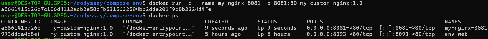

### 4. 접속 증거

**8080 접속 (STEP 5에서 확인)**
- curl, 브라우저(주소창 `localhost:8080`), 접속 로그는 STEP 5의 "7. 검증" 참고


**8081 접속 확인**   
| 8081 curl 응답 화면 캡처 | 8081 브라우저 접속(주소창 `localhost:8081` + 응답 화면) | 
|---|---| 
| 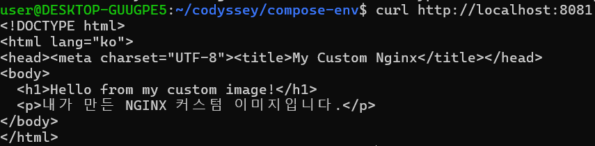 | 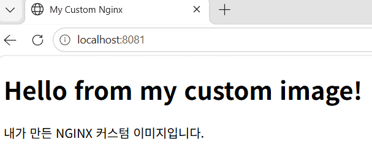 | 


**8081 접속 로그**
```bash
$ docker logs --tail 5 my-nginx-8081
```
- curl과 Chrome의 `GET /` 요청이 모두 `200`으로 8081 컨테이너에 도달함 (로그 시각은 UTC)
- `favicon.ico 404`는 브라우저가 탭 아이콘을 자동으로 요청했으나 `site/`에 해당 파일이 없어서 발생한 것으로, 페이지 응답(`200`)에는 영향이 없다.

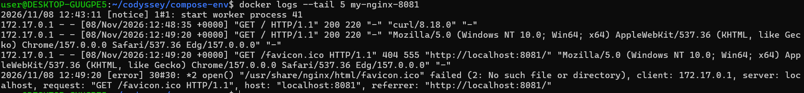

### 5. 검증 요약

| 검증 항목 | 명령 | 결과 |
|---|---|---|
| 같은 이미지로 컨테이너 2개 실행 | `docker ps` | `my-nginx`(8080), `my-nginx-8081`(8081) 모두 Up |
| 호스트 포트별 매핑 | `docker ps`의 PORTS | `8080->80`, `8081->80` |
| 8081 접속 | `curl`, 브라우저 | 커스텀 HTML 응답 |
| 요청 도달 | `docker logs` | `GET / ... 200` |

### 6. 정리 (이 단계에서 이해한 점)
- 포트 매핑 `-p 호스트:컨테이너`는 격리된 컨테이너를 호스트에서 접근 가능하게 연결하는 설정이다.
- 하나의 이미지로 컨테이너를 여러 개 만들 수 있고, 호스트 포트만 다르게 하면 동시에 실행된다.

-------------------------------------------------------------------------------------- 
## 📌 STEP 7.Docker 볼륨 영속성 검증 
--------------------------------------------------------------------------------------  

### 1. 목표
- Docker 볼륨을 생성하고 컨테이너에 연결한다.
- 컨테이너를 삭제한 뒤에도 볼륨의 데이터가 유지되는지 삭제 전/후로 확인한다.

### 2. 개념
- **볼륨(Volume)**: Docker가 관리하는 저장 공간. 컨테이너와 수명이 분리되어 있어, 컨테이너를 삭제해도 볼륨은 남는다.
- 컨테이너 안에만 저장한 데이터는 컨테이너를 삭제하면 함께 사라진다.
- `-v 볼륨이름:컨테이너경로` 형식으로 연결한다. (왼쪽이 경로가 아니라 **볼륨 이름**이면 볼륨, 호스트 절대 경로이면 바인드 마운트)

### 3. 볼륨 영속성 검증 확인 
- 사용할 볼륨 이름(`mydata`)과 컨테이너 이름(`vol-test`, `vol-test2`)이 기존 것과 겹치지 않는지 확인


#### 1. 볼륨 생성

```bash
$ docker volume ls
$ docker ps -a
$ docker volume create mydata       #볼륨 생성
$ docker volume ls
```

#### 2. 컨테이너에 연결하고 데이터 저장
```bash
$ docker run -it --name c1 -v myvol:/data ubuntu bash
$ echo "hello volume" > /data/test.txt
-v myvol:/data : 볼륨을 컨테이너의 /data 경로에 마운트
/data/test.txt에 데이터를 기록합니다.
```


컨테이너 c1 의 데이터를 볼륨으로 이동한 후 확인 스크린 샷


#### 3. 컨테이너 삭제 
```bash
$ docker rm c1
```
- 컨테이너(`c1`)는 삭제되었지만 볼륨(`mydata`)은 그대로 남아 있음

#### 4. 새 컨테이너에 같은 볼륨 연결 후 데이터 확인
```bash
docker run -it --name c2 -v myvol:/data ubuntu bash
cat /data/test.txt   # "hello volume" 출력되면 성공!
```
- 삭제된 컨테이너에서 저장한 `hello.txt`가 새 컨테이너에서도 읽힘 → **데이터 영속성 확인**


#### 5. 삭제 전/후 비교

| 시점 | 컨테이너 | 볼륨 `mydata` | `/data/hello.txt` |
|---|---|---|---|
| 삭제 전 | `vol-test` 실행 중 | 존재 | `hi` 저장 |
| 삭제 후 | `vol-test` 없음 | **존재** | (볼륨에 보존) |
| 재연결 후 | `vol-test2` 실행 중 | 존재 | **`hi` 확인** |

### 4. 검증 요약

| 검증 항목 | 명령 | 결과 |
|---|---|---|
| 볼륨 생성 | `docker volume create`, `docker volume ls` | `mydata` 생성 |
| 볼륨 연결 및 쓰기 | `docker run -v`, `docker exec` | `/data/hello.txt`에 `hi` 저장 |
| 컨테이너 삭제 후 볼륨 유지 | `docker rm -f`, `docker volume ls` | 컨테이너만 삭제, 볼륨 유지 |
| 데이터 영속성 | `docker exec ... cat` | 새 컨테이너에서 `hi` 확인 |

### 5. 정리 (이 단계에서 이해한 점)
- 컨테이너의 수명과 데이터의 수명은 분리할 수 있고, 그 수단이 볼륨이다.
- 컨테이너는 언제든 삭제·재생성할 수 있는 "교체 가능한 실행체"이고, 보존할 데이터는 볼륨에 둔다.


-------------------------------------------------------------------------------------- 
## 📌 STEP 8.바인드 마운트 반영 검증
-------------------------------------------------------------------------------------- 

### 1. 목표
- 호스트(내 PC)의 폴더를 컨테이너에 바인드 마운트로 연결한다.
- 호스트에서 파일을 수정하면, 컨테이너를 다시 만들거나 이미지를 다시 빌드하지 않아도 응답에 바로 반영되는지 변경 전/후로 확인한다.

### 2. 개념
- **바인드 마운트(Bind Mount)**: 호스트의 특정 경로를 컨테이너 안의 경로에 그대로 연결하는 방식. 같은 파일을 호스트와 컨테이너가 함께 본다.
- `-v 호스트절대경로:컨테이너경로` 형식으로 연결한다.
- STEP 5의 `COPY`는 **빌드할 때 한 번 복사**하는 방식이라 내용을 바꾸려면 이미지를 다시 빌드해야 하지만, 바인드 마운트는 **호스트 파일 변경이 즉시 반영**된다.

| 구분 | `COPY` (STEP 5) | 바인드 마운트 (STEP 8) |
|---|---|---|
| 파일 위치 | 이미지 안에 복사됨 | 호스트 폴더를 연결 |
| 호스트에서 수정 시 | 반영 안 됨 (재빌드 필요) | 즉시 반영 |

### 3. 실행 실습

#### 1. 바인드 마운트로 컨테이너 실행
```bash
$ docker run -d --name bind-test -p 8082:80 -v "$(pwd)/site":/usr/share/nginx/html my-custom-nginx:1.0
$ docker ps
- `-v "$(pwd)/site":/usr/share/nginx/html`: 호스트의 `site` 폴더를 컨테이너의 NGINX 웹 루트에 연결
- `$(pwd)`: 현재 위치(절대 경로)로 치환되며, 바인드 마운트의 호스트 경로는 절대 경로여야 함
```
> bind-test, 8082->80 실행 화면


```bash
$ cat site/index.html                                                                    #변경 전 상태
$ curl http://localhost:8082

#호스트에서 파일 수정 (컨테이너는 건드리지 않음)
$ sed -i 's/Hello from my custom image!/Hello from BIND MOUNT!/' site/index.html         

- `sed -i 's/찾을글자/바꿀글자/' 파일`: 파일 안의 문구를 찾아 바꿔서 저장
- 컨테이너 재시작, 이미지 재빌드는 **하지 않음**

$ cat site/index.html                                                                    #변경 후 상태
$ curl http://localhost:8082
```

#### 변경 전/후 비교

| 구분 | 호스트 `site/index.html` | `curl http://localhost:8082` 응답 | 컨테이너 재시작/재빌드 | 
|---|---|---|---|
| 변경 전 |  | | - |
| 변경 후 |  | | **하지 않음** |

#### 검증 요약

| 검증 항목 | 명령 | 결과 |
|---|---|---|
| 바인드 마운트 연결 | `docker run -v "$(pwd)/site":...` | `bind-test` 실행, `8082->80` |
| 변경 전 응답 | `curl` | 기존 문구 |
| 호스트 파일 수정 | `sed -i` | `site/index.html` 변경 |
| 변경 후 응답 | `curl`, 브라우저 | 수정한 문구가 재시작 없이 반영 |

### 정리 (이 단계에서 이해한 점)
- 바인드 마운트는 호스트와 컨테이너가 같은 파일을 공유해서, 개발 중 코드를 고치면 바로 확인할 수 있다.
- `COPY`는 이미지에 내용을 고정하는 방식이고, 바인드 마운트는 실행 시점에 호스트 파일을 연결하는 방식이다.
- 볼륨(STEP 7)은 Docker가 관리하는 저장 공간이고, 바인드 마운트는 호스트의 경로를 직접 지정한다는 점이 다르다.

-------------------------------------------------------------------------------------- 
## 📌 STEP 9.Git 설정 및 GitHub 연동  
--------------------------------------------------------------------------------------  

### Git과 GitHub의 역할 차이

git config 출력 화면 (스크린 샷)  


| 구분 | Git | GitHub |
|---|---|---|
| 정체 | 버전 관리 도구(프로그램) | Git 저장소를 올려 협업하는 원격 플랫폼(서비스) |
| 위치 | 내 PC(로컬) | 인터넷(원격) |
| 하는 일 | 변경 이력을 커밋으로 기록, 브랜치 관리 | 저장소 공유, 협업, 백업, 제출 |
| 대표 명령 | `git add`, `git commit` | `git push`, `git pull`(원격과 주고받기) |


### 트러블슈팅 2: git pull 시 추적 브랜치(upstream) 정보 없음

- **문제**: `git pull` 실행 시 원격 저장소에서 객체는 받아왔지만, 병합 단계에서 아래 메시지가 나오며 중단됨
  ```
  From https://github.com/goodday-min/Start_Mission1
     a502009..dce431e  main       -> origin/main
  There is no tracking information for the current branch.
  Please specify which branch you want to merge with.
  ```
- **원인 가설**  
로컬 브랜치 이름은 `master`, 원격 브랜치 이름은 `main`으로 서로 달라서, 로컬 `master`에 연결된 원격 브랜치(upstream)가 설정되어 있지 않음. 그래서 `git pull`이 어느 브랜치와 병합할지 알 수 없음
- **확인**:
  - `git branch -a` → 로컬은 `* master`만 있고, 원격은 `remotes/origin/main`
  - `git status` → 추적되지 않은 파일만 있고 변경된 파일은 없음을 확인 (병합해도 로컬 작업 손실 없음)
  **해결**:
  ```bash
  git branch -m master main                      # 로컬 브랜치 이름을 main으로 변경
  git branch --set-upstream-to=origin/main main  # main과 origin/main 연결
  git pull                                       # 이후부터는 git pull만으로 동작
  ```
  **대안**: 이름을 바꾸지 않고 한 번만 브랜치를 지정해서 실행 → `git pull origin main` 

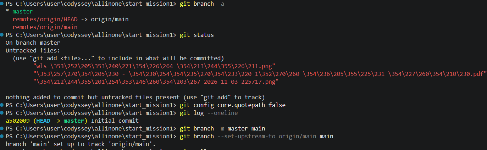
-------------------------------------------------------------------------------------- 
## 📌 보너스 1. Docker Compose 기초 — 단일 서비스 실행
-------------------------------------------------------------------------------------- 

### 1. 목표
- `docker-compose.yml`의 기본 구조를 학습하고, 단일 서비스(웹 서버)를 Compose로 실행한다.
- 컨테이너 실행 명령(`docker run ...`)이 "문서화된 실행 설정"으로 바뀌는 이유를 이해한다.

### Docker Compose란?
- 컨테이너의 실행 설정(이미지, 이름, 포트 등)을 **YAML 파일**에 적어 두고, 명령 한 줄로 실행·종료하는 도구이다.
- 서비스가 하나여도 사용할 수 있고, 이후 여러 서비스를 함께 관리하는 데 확장된다.

```bash
$ docker compose version                              #Compose 설치 확인

cat > docker-compose.yml << 'EOF'
services:                                              #실행할 컨테이너(서비스)들을 적는 영역
  web:                                                 #서비스 이름 (직접 정함)
    image: my-custom-nginx:1.0                         #사용할 이미지.(직접 빌드한 이미지, STEP 5에서 만든 것)
    container_name: compose-web                        #컨테이너 이름 (`docker run --name`에 해당)
    ports:
      - "8090:80"                                      #포트 매핑     (`docker run -p`에 해당)
EOF
cat docker-compose.yml
```
> docker-compose.yml 작성 캡쳐 화면


### Docker Compose 실행 및 확인
```bash
docker-compose 실행 및 결과 확인
```bash
docker compose up -d                                  #실행
curl http://localhost:8090
docker compose down                                   #종료
docker ps -a
```

> docker compose 실행및 결과확인

| WSL | 브라우저 |
|---|---|
|  |  | 


### 배운 점: 컨테이너 실행 명령이 "문서화된 실행 설정"으로 바뀌는 이유

**① `docker run`의 옵션이 yml 항목과 1:1로 대응된다**

| `docker run` 옵션 | `docker-compose.yml` 항목 |
|---|---|
| `my-custom-nginx:1.0` (이미지) | `image: my-custom-nginx:1.0` |
| `--name compose-web` | `container_name: compose-web` |
| `-p 8090:80` | `ports: - "8090:80"` |
| `-d` | `docker compose up -d`의 `-d` |

**② 실행 방법이 명령이 아니라 파일에 남는다**
- `docker run`은 옵션을 매번 직접 입력해야 하고, 입력한 내용은 터미널 기록에만 남는다.
- Compose는 설정을 `docker-compose.yml`에 적어 두고 `docker compose up -d` 한 줄로 실행한다.
- 파일이 곧 "이 서비스를 어떻게 실행하는지" 설명하는 문서가 되어, 다른 사람이 그 파일만 받아도 같은 구성을 재현할 수 있다.

**③ 같은 설정으로 반복 실행해도 같은 결과가 나온다**
- `up -d` → `down` → `up -d`를 반복해도 같은 컨테이너(`compose-web`)가 같은 포트(`8090->80`)로 실행되는 것을 확인했다.
- 옵션을 다시 입력하지 않으므로 오타나 옵션 누락으로 인한 차이가 줄어든다.

**④ 상태 확인과 종료도 같은 단위로 관리된다**
- `docker compose ps`는 이 yml로 실행한 컨테이너의 상태만 보여주고, `docker compose down`은 컨테이너와 네트워크를 함께 정리한다.

**⑤ Dockerfile과 Compose의 역할 차이**

| 구분 | 정의하는 것 | 이번 실습 |
|---|---|---|
| `Dockerfile` | **이미지 내부**에 무엇이 들어가는지 | `nginx:alpine` 위에 내 `index.html`을 복사 |
| `docker-compose.yml` | 그 이미지를 **어떤 이름·포트로 실행할지** | 이름 `compose-web`, 포트 `8090:80` |


--------------------------------------------------------------------------------------
## 📌 보너스 2. Docker Compose 멀티 컨테이너 — 웹 서버 + 보조 서비스
--------------------------------------------------------------------------------------

### 1. 목표
- 웹 서버와 보조 서비스, 2개 서비스를 Compose로 함께 실행한다.
- 컨테이너 간 네트워크 통신이 가능한지 확인한다.
- 네트워크와 서비스 디스커버리(서비스 이름으로 서로 찾기) 개념을 이해한다.

### 2. 구성

| 서비스 | 이미지 | 역할 | 호스트 포트 |
|---|---|---|---|
| `web` | `my-custom-nginx:1.0` | 웹 서버 (STEP 5에서 만든 이미지) | `8091:80` |
| `helper` | `alpine` | 보조 서비스. `web`에 요청을 보내 통신을 확인하는 역할 | 없음 |

### 3. 작업 폴더 및 docker-compose.yml 작성
```bash
$ mkdir -p ~/codyssey/compose-multi
$ cd ~/codyssey/compose-multi

$ cat > docker-compose.yml << 'EOF'
services:
  web:                                          #서비스 이름. 같은 네트워크에서 **컨테이너끼리 서로를 부르는 주소**가 됨
    image: my-custom-nginx:1.0
    container_name: multi-web
    ports:
      - "8091:80"
  helper:                                       #서비스 이름. 
    image: alpine
    container_name: multi-helper
    command: sleep infinity
EOF
$ cat docker-compose.yml
```

> docker-compose.yml 화면 캡쳐


### 4. 실행

```bash
$ docker compose up -d                        #실행
$ docker compose ps

```
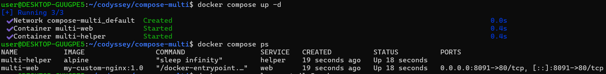

- 서비스 2개가 한 번에 실행됨
- Compose가 이 프로젝트 전용 네트워크를 자동으로 생성하고, 같은 네트워크의 서비스는 **서비스 이름**으로 서로를 찾을 수 있음


### 5. 컨테이너 간 통신 확인

**① `helper` → `web` HTTP 요청**
```bash
$ docker compose exec helper wget -qO- http://web
```
- 주소가 `localhost`나 IP가 아니라 **서비스 이름 `web`**이고, 포트는 호스트 포트(8091)가 아니라 **컨테이너 포트(80, 기본값)** 로 통신함
  
**② `helper` → `web` 이름 확인 (ping)**
```bash
$ docker compose exec helper ping -c 2 web
```
- 서비스 이름 `web`이 컨테이너 내부 IP(`172.18.0.2`)로 변환되어 응답이 옴 (서비스 디스커버리)
  
| wget 실행 화면 캡처 | ping 실행 화면 캡처 | 
|---|---|
| **`helper` → `web` HTTP 요청** | **`helper` → `web` 이름 확인 (ping)** |
| | | 


** 호스트(내 PC)에서 접속**
```bash
$ curl http://localhost:8091
```

| wsl 화면 실행 화면 캡처 | 브라우저 실행 화면 캡처 | 
|---|---| 
|  |  | 


### 6. 배운 점: 네트워크와 서비스 디스커버리
- **서비스 이름이 주소가 된다**: 같은 Compose 네트워크 안에서는 IP를 몰라도 `http://web`처럼 서비스 이름으로 상대 컨테이너를 찾을 수 있다. 컨테이너가 다시 만들어져 IP가 바뀌어도 이름은 그대로라서 설정이 단순해진다.
- **컨테이너 간 통신은 컨테이너 포트를 쓴다**: 호스트 포트(8091)는 내 PC에서 접속할 때만 필요하고, 컨테이너끼리는 컨테이너 포트(80)로 직접 통신한다.
- **호스트에 노출하는 범위를 선택할 수 있다**: `web`만 포트를 열고 `helper`는 열지 않았지만, 둘은 같은 네트워크 안에서 통신된다.
- **한 파일로 여러 서비스를 관리한다**: 보너스 1의 단일 서비스에서 `services` 아래에 서비스를 추가하는 것만으로 멀티 컨테이너 구성이 되고, `up`/`down` 한 번으로 모두 함께 실행·종료된다.


--------------------------------------------------------------------------------------

## 📌 보너스 3. Compose 운영 명령어 — up / down / ps / logs

--------------------------------------------------------------------------------------

### 1. 목표
- `up`, `down`, `ps`, `logs`로 서비스의 실행·종료·상태 확인·로그 확인을 관리한다.
- 운영 관점의 "상태 확인 루틴"을 만든다.

### 2. 사용한 명령어

| 명령 | 역할 |
|---|---|
| `docker compose up -d` | yml에 정의된 서비스를 백그라운드로 실행 |
| `docker compose ps` | 이 yml로 실행한 서비스의 상태 확인 |
| `docker compose logs [서비스]` | 서비스의 로그 확인 (`--tail N`: 마지막 N줄, `-f`: 실시간) |
| `docker compose down` | 서비스(컨테이너)와 Compose가 만든 네트워크를 중지·삭제 |


- 컨테이너가 `Up`인 것과 서비스가 실제로 응답하는 것은 별개라서, 상태(`ps`) → 원인(`logs`) → 실제 응답(`curl`)을 함께 확인한다.


### 배운 점: 운영 관점의 "상태 확인 루틴"

| 순서 | 명령 | 알 수 있는 것 |
|---|---|---|
| ① | `docker compose ps` | **상태**: 서비스가 떠 있는지, 포트가 맞는지 |
| ② | `docker compose logs` | **원인**: 에러나 접속 기록 등 무슨 일이 있었는지 |
| ③ | `curl` | **실제 응답**: 서비스가 요청에 응답하는지 |

- 문제가 생기면 위 순서로 좁혀 가면 어느 단계에서 이상이 생겼는지 알 수 있다.
- `docker run` 중심 작업에서는 컨테이너마다 이름을 기억해 개별 명령을 입력해야 했지만, Compose는 같은 yml에 묶인 서비스들을 `ps`, `logs`, `down` 한 번으로 함께 관리한다.
- `ps`는 기본으로 실행 중인 서비스만 보여주므로, 중지된 서비스까지 확인하려면 `-a`를 쓴다.


--------------------------------------------------------------------------------------
## 📌 보너스 4. 환경 변수 활용 — 설정과 코드의 분리
--------------------------------------------------------------------------------------

### 1. 목표
- Compose에서 환경 변수를 주입해 서버 포트와 모드(`APP_ENV`)를 바꿔 본다.
- 이미지와 `docker-compose.yml`은 그대로 두고 **설정 값만 바꿔서** 동작이 달라지는 것을 확인한다.

### 2. 개념
- **환경 변수**: 프로그램 밖에서 값을 전달하는 방법. 코드(yml, 이미지)를 고치지 않고 설정만 바꿀 수 있다.
- **`.env` 파일**: 변수 값을 모아 둔 파일. Compose가 같은 폴더의 `.env`를 읽어 yml의 `${변수}`를 치환한다.
- Dockerfile의 `ENV`는 이미지 안의 **기본값**이고, Compose의 `environment`로 **덮어쓸 수 있다.**

### 3. 구성

| 설정 | 변경 전 | 변경 후 |
|---|---|---|
| `WEB_PORT` (호스트 포트) | `8092` | `8093` |
| `APP_ENV` (모드) | `dev` | `prod` |

- 사용 이미지: `my-custom-nginx:1.0` (STEP 5에서 빌드, Dockerfile에 `ENV APP_ENV=dev` 포함)
- NGINX는 `APP_ENV`를 읽어 동작을 바꾸지 않는다. `APP_ENV`는 **값이 컨테이너에 주입되는 것**을 확인하는 용도이고, 실제 동작이 달라지는 것은 포트이다.

### 4. 작업 폴더와 파일 작성
```bash
$ cat > .env << 'EOF'
WEB_PORT=8092
APP_ENV=dev
EOF
$ cat .env

$ cat > docker-compose.yml << 'EOF'
services:
  web:
    image: my-custom-nginx:1.0
    container_name: env-web
    ports:
      - "${WEB_PORT}:80"
    environment:
      - APP_ENV=${APP_ENV}
EOF
$ cat docker-compose.yml
```
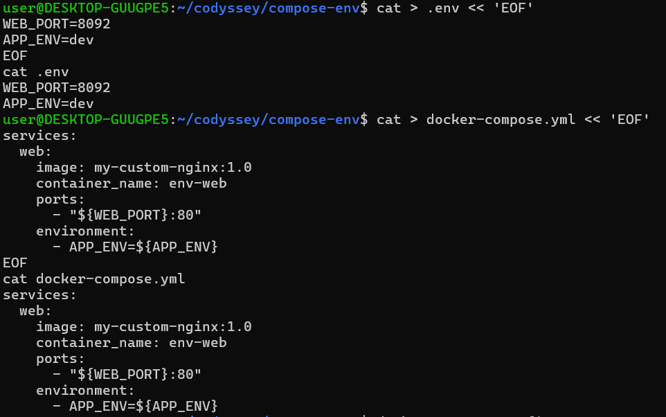

| yml 항목 | 의미 |
|---|---|
| `${WEB_PORT}` | `.env`의 `WEB_PORT` 값으로 치환 |
| `environment:` | 컨테이너 안에 환경 변수를 주입 (`docker run -e`에 해당) |
| `${APP_ENV}` | `.env`의 `APP_ENV` 값으로 치환 |

### 5. 치환 결과 확인
```bash
$ docker compose config
```
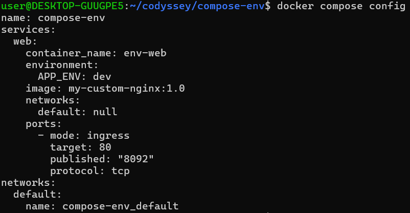

### 6. 변경 전 실행 (dev, 8092)
```bash
$ docker compose up -d
$ docker compose ps
$ curl http://localhost:8092
$ docker compose exec web env | grep APP_ENV
APP_ENV=dev
```
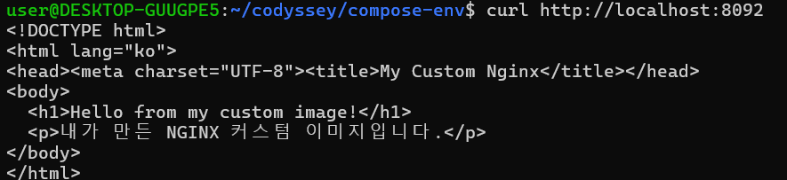


### 7. `.env`만 수정해서 재실행 (prod, 8093)
```bash
$ sed -i 's/^WEB_PORT=.*/WEB_PORT=8093/; s/^APP_ENV=.*/APP_ENV=prod/' .env
$ cat .env
WEB_PORT=8093
APP_ENV=prod

$ docker compose up -d
$ docker compose ps

$ curl http://localhost:8093
$ docker compose exec web env | grep APP_ENV
APP_ENV=prod
$ curl http://localhost:8092
```

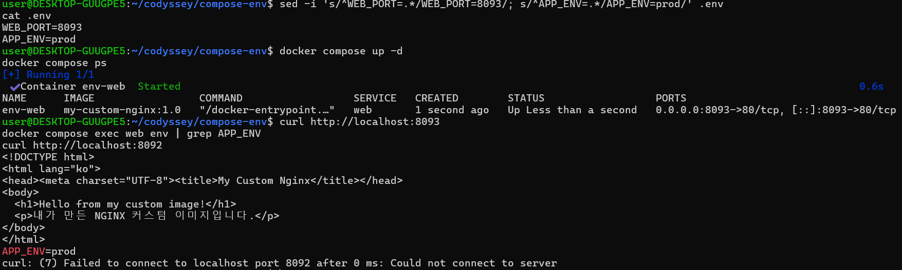


- `docker-compose.yml`과 이미지는 **수정하지 않고** `.env`의 두 줄만 바꿨다.
- 포트가 `8092` → `8093`으로 바뀌어 `8093`은 응답하고 `8092`는 연결되지 않는다.
- `APP_ENV`가 `dev` → `prod`로 바뀌었고, 이미지의 `ENV APP_ENV=dev`(기본값)를 Compose의 `environment`가 덮어썼다.

|변경 전|변경 후|
|---|---|
|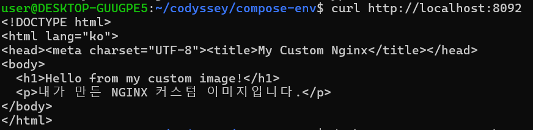 | 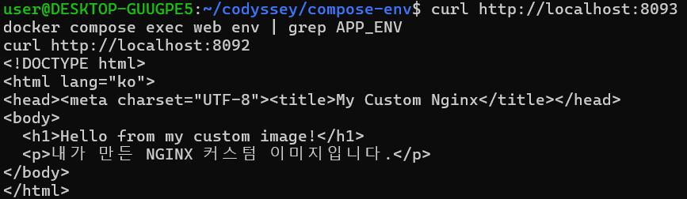

### 8. 검증 요약

| 검증 항목 | 명령 | 결과 |
|---|---|---|
| 변수 치환 | `docker compose config` | `.env` 값이 yml에 적용됨 |
| 변경 전(dev, 8092) | `ps`, `curl`, `env` | `8092->80`, `APP_ENV=dev` |
| 설정만 변경 | `sed -i ... .env`, `up -d` | yml·이미지 수정 없이 재실행 |
| 변경 후(prod, 8093) | `ps`, `curl`, `env` | `8093->80`, HTML 응답, `APP_ENV=prod` |
| 이전 포트 해제 | `curl http://localhost:8092` | 연결 실패 |

### 9. 배운 점: 설정과 코드의 분리
- **같은 이미지, 같은 yml로 설정만 바꿨다**: `.env`의 값만 수정해서 포트와 모드가 달라졌다. 코드를 고치거나 이미지를 다시 빌드할 필요가 없다.
- **환경별 구성을 재사용할 수 있다**: 개발(dev)과 운영(prod)처럼 값만 다른 환경에서 같은 구성을 쓰고, 달라지는 값만 `.env`로 분리하면 된다.
- **값의 우선순위**: 이미지(Dockerfile)의 `ENV`는 기본값이고, Compose의 `environment`가 이를 덮어쓴다.
- **비밀 값 주의**: `.env`는 비밀번호나 토큰 같은 민감한 값을 두는 용도로도 쓰이므로, 실제 운영에서는 저장소에 올리지 않도록 관리한다. 이번 실습의 값은 민감하지 않은 예시 값이다.


