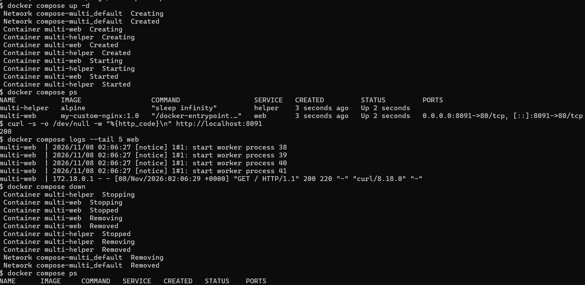

--------------------------------------------------------------------------------------  
## 📌 보너스 3. Compose 운영 명령어 습득
--------------------------------------------------------------------------------------  

### 1. 목표
- `up`, `down`, `ps`, `logs`를 사용해 서비스를 실행 / 종료 / 상태 확인 / 로그 확인으로 관리한다.
- 운영 관점의 "상태 확인 루틴"(`ps` → `curl` → `logs`)을 만든다.

### 2. 개념
- **Docker Compose**: 여러 컨테이너(서비스)의 실행 설정을 YAML 파일 하나에 적어 두고, 명령 하나로 함께 관리하는 도구
- `docker compose` 명령은 Compose 설정 파일이 있는 폴더(`~/compose-multi`)에서 실행한다.
- 서비스 이름(`web`, `helper`)은 설정 단위의 이름이고, 실제로 실행되는 컨테이너 이름은 `multi-web`, `multi-helper`이다.

| 명령어 | 역할 |
|---|---|
| `docker compose up -d` | 서비스를 만들고 백그라운드로 실행 (네트워크도 함께 생성) |
| `docker compose ps` | Compose 프로젝트의 컨테이너 상태 확인 |
| `docker compose logs` | 서비스의 출력·접속 로그 확인 (`--tail 5`: 마지막 5줄) |
| `docker compose down` | 서비스를 중지하고 컨테이너와 네트워크를 삭제 (이미지는 삭제하지 않음) |

### 3. 실습

**실습 프로젝트**: `~/compose-multi`

| 서비스 | 이미지 | 설명 |
|---|---|---|
| `web` | `my-custom-nginx:1.0` | 호스트 `8091` → 컨테이너 `80` 포트 연결 |
| `helper` | `alpine` | `sleep infinity`로 계속 실행되는 보조 컨테이너 |

#### 1. 서비스 실행

```bash
$ cd ~/compose-multi
$ docker compose up -d       # 서비스 생성 + 백그라운드 실행
```
- 네트워크 `compose-multi_default`가 만들어지고, `multi-web`, `multi-helper` 컨테이너가 `Created` → `Started` 됨

#### 2. 상태 확인

```bash
$ docker compose ps
```
- 두 서비스 모두 `Up` 상태이고, `multi-web`은 `0.0.0.0:8091->80/tcp`로 연결됨

#### 3. 응답 확인

```bash
$ curl -s -o /dev/null -w "%{http_code}\n" http://localhost:8091
200
```
- `-s`: 진행 표시 숨김 / `-o /dev/null`: 본문은 버림 / `-w "%{http_code}\n"`: HTTP 응답 코드만 출력
- `200`이면 웹 서버가 정상적으로 응답한 것

#### 4. 로그 확인

```bash
$ docker compose logs --tail 5 web
```
- nginx worker process 시작 로그와 방금 보낸 요청 `GET / HTTP/1.1" 200` (`curl/8.18.0`)이 기록됨 (로그 시각은 UTC)

#### 5. 서비스 종료

```bash
$ docker compose down        # 컨테이너 + 네트워크 삭제
$ docker compose ps          # 종료 후 상태 재확인
```
- `multi-web`, `multi-helper` 컨테이너와 네트워크 `compose-multi_default`가 `Removed` 됨
- 종료 후 `docker compose ps`는 빈 목록



### 4. 검증 요약

| 검증 항목 | 명령 | 결과 |
|---|---|---|
| 서비스 실행 | `docker compose up -d` | 네트워크·컨테이너 2개 생성 후 `Started` |
| 상태 확인 | `docker compose ps` | `multi-web`, `multi-helper` `Up`, `8091->80` |
| 응답 확인 | `curl` | HTTP `200` |
| 로그 확인 | `docker compose logs --tail 5 web` | 방금 보낸 `GET / ... 200` 요청 기록 |
| 서비스 종료 | `docker compose down` | 컨테이너·네트워크 `Removed`, `ps` 목록 비어 있음 |

### 5. 정리 (이 단계에서 이해한 점)
- `up` → `ps` → `curl` → `logs` → `down` 순서로 서비스의 실행부터 종료까지 한 흐름으로 관리할 수 있다.
- **상태 확인 루틴**: `ps`의 `Up`은 컨테이너가 떠 있다는 뜻일 뿐이므로, `curl`로 실제 응답을 확인하고 `logs`로 요청이 서버에 도달했는지까지 봐야 정상 여부를 판단할 수 있다.
- `docker run`은 컨테이너 하나를 직접 다루고, `docker compose`는 여러 서비스를 설정 파일 기준으로 한 번에 실행·종료한다.
